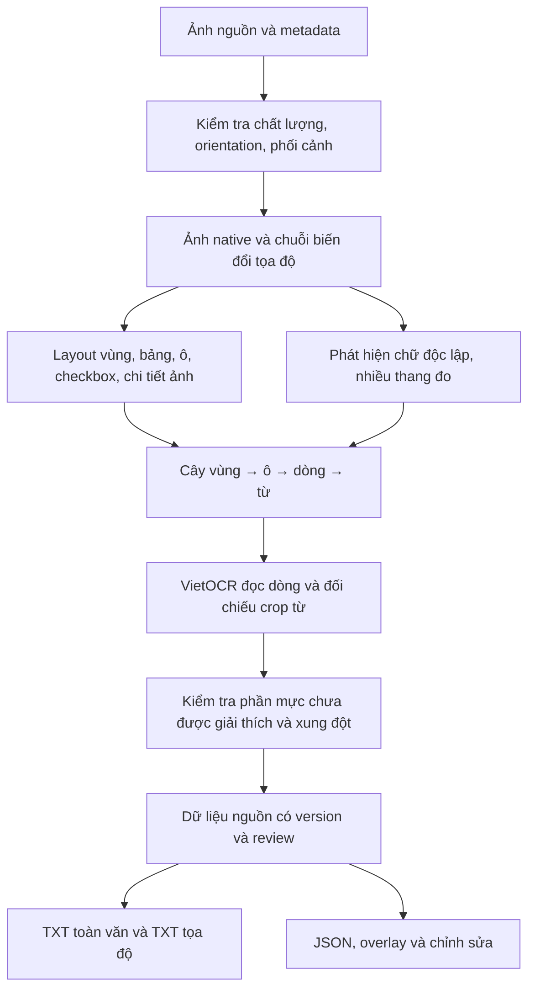

# Kế hoạch nâng cấp OpenCV và xuất TXT theo tọa độ

Ngày khảo sát: 11/10/2026. Mã nguồn được khảo sát: `864320f`.

**Cập nhật triển khai:** người dùng đã cho phép triển khai trực tiếp sau khảo sát. Xem [báo cáo triển khai và kiểm chứng](OPENCV-DETAILED-TXT-IMPLEMENTATION.md) cùng [TXT mẫu từ OCR thật](examples/detailed-txt/README.md). Các mô tả “hiện tại” dưới đây ghi nhận trạng thái ở thời điểm khảo sát; lộ trình dài hạn không đồng nghĩa tất cả benchmark ảnh thật đã hoàn tất.

Phạm vi người dùng đã chọn: **vùng → dòng → từ và mọi ô biểu mẫu**, gồm ô trống, checkbox, phần đầu/cuối trang và vùng không đọc được. Tọa độ từng ký tự không thuộc đợt này. “Từ” trong phiên bản đầu là đơn vị văn bản ngăn bởi khoảng trắng, với quy tắc riêng cho dấu câu; không đồng nghĩa phân tích từ ghép tiếng Việt.

Đây là **Spike: khảo sát, chạy kiểm thử và lập kế hoạch**, chưa thay đổi thuật toán. Theo `AGENTS.md`, Spike không bắt đầu delivery run. Khi triển khai các thay đổi Bounded/Architectural phải dùng `dely:delivery`. Skill này chưa được tìm thấy trong workspace hoặc thư mục skills/plugins đã kiểm tra; cần khôi phục trước đợt triển khai, với implement/review theo cấu hình AGENTS.md, không tự thay model.

## 1. Kết luận và mục tiêu

Pipeline cần một mô hình phân cấp có bằng chứng ảnh cho từng phần tử. Chỉ hạ ngưỡng contour hoặc tăng số candidates không giải quyết việc mất dòng con, thiếu tọa độ từ và sai hệ tọa độ.

Ba tiêu chí phải đo riêng:

1. **Phát hiện đủ:** tìm đúng vùng, dòng, từ, ô bảng, checkbox và chi tiết phi văn bản.
2. **Đọc đúng:** chữ, dấu tiếng Việt, số 0 đầu, dấu câu và thứ tự đọc.
3. **Xuất đủ:** mọi phần tử đã phát hiện có bản ghi, tọa độ và trạng thái; không bị mất trong API, ghép nội dung hay tải TXT.

Không thể cam kết đọc chính xác 100% mọi ảnh, đặc biệt ảnh mất nét/cắt mất nội dung. Yêu cầu kỹ thuật là: không âm thầm loại vùng đã phát hiện; lưu dấu vết vùng nghi vấn; hiển thị phần chưa đọc được; đo phần bỏ sót trên dữ liệu gán nhãn độc lập. Kiểm tra phần mực còn dư chỉ là chỉ báo, không phải chứng minh không còn chi tiết bị bỏ sót.

## 2. Những gì đã xác minh

| Vị trí | Hành vi hiện tại | Ảnh hưởng tới yêu cầu |
| --- | --- | --- |
| `src/modules/opencv/box-filter.ts:99` | `mergeFormCandidates` loại field rows/phrase clusters nằm trong ô bảng | Mất phần tử dòng/cụm con dù vẫn có vùng ô cha; chưa phải bằng chứng chữ luôn mất |
| `src/modules/opencv/row-detector.ts:19` | Kernel 14×3, minHeight 8, minArea 90; phân loại theo bề rộng | Ngưỡng pixel cố định phụ thuộc độ phân giải; không cung cấp cây dòng/từ |
| `src/modules/opencv/line-segmentation.ts:24` | Kernel 25×3, minHeight 6, minArea 80 | Có nguy cơ gộp/tách sai với cỡ chữ, dấu và khoảng cách khác nhau |
| `src/app/opencv-test/page.tsx:25` | Detection trên ảnh cạnh dài tối đa 1600 px; giữ canvas gốc để crop OCR | OCR có ảnh gốc nhưng chi tiết không được detector tìm thấy sẽ không được crop |
| `src/app/opencv-test/page.tsx:464` | Bỏ container; crop mỗi candidate thành một đầu vào OCR | Container có cấu trúc không được lưu thành cây, ô nhiều dòng thiếu con ở đầu ra |
| `services/vietocr-service/app.py:375` | Có phân dòng crop cao, nhưng gán tọa độ cha cho từng subregion, sau đó ghép chữ về cha | Tọa độ từng dòng con bị mất; phần rỗng bị loại khỏi danh sách `parts` khi ghép |
| `services/vietocr-service/segmentation.py:187` | Phân trang Python thích ứng chiều cao chữ, có hồi phục native khi chữ nhỏ, giữ ô trống bảng đầy đủ | Nền tảng tốt để mở rộng, không cần viết lại mọi thứ |
| `services/vietocr-service/segmentation.py:153` | Lưới bảng chỉ chấp nhận đường phân chia đầy đủ; từ chối nhiều trường hợp đứt/gộp | Cần bổ sung topology bảng, không tự suy ra các ô bằng lưới đều |
| `src/modules/documents/providers/vietocr-provider.ts:89` và candidate assembler | `tokens: []` | Chưa có đầu ra từ và tọa độ từng từ |
| `src/modules/opencv/perspective-transform.ts:32` | Ma trận warp bị giải phóng, không trả metadata transform | Chưa đủ dữ liệu truy ngược mọi polygon về ảnh gốc xuyên suốt pipeline |
| `src/shared/document-export.types.ts:1` | JSON dùng XYXY; hợp đồng OCR/Form dùng YXYX | Phải có adapter rõ ràng, tránh đảo x/y khi xuất TXT |
| `src/modules/documents/config.ts:27` | Candidate OCR giới hạn 70 vùng; service Python giới hạn 1000 | Hiện báo lỗi thay vì tự cắt, nhưng chưa có luồng xử lý tài liệu dày ở mức từ |
| `src/app/opencv-test/page.tsx:35` | Crop thêm padding nhưng tọa độ gửi đi vẫn là rect trước padding | Cần phân biệt hộp nội dung và hộp crop, nhất là khi quy đổi tọa độ con |
| `src/app/opencv-test/page.tsx:53` | Checkbox dùng tỷ lệ pixel tối; `catch` trả `false` | Lỗi đọc pixel có thể thành “không tích”; phải trả `unknown` và lý do |
| `src/modules/documents/candidate-json-assembler.ts:9` | Sắp xếp lại theo y rồi x khi ghép JSON | Có thể làm mất thứ tự phân cấp đã tính trước, nhất là nhiều cột/khối ký tên |
| Luồng `/opencv-test` và modules documents đã kiểm tra | Xuất JSON, chưa thấy bộ xuất TXT tọa độ chuyên biệt | Cần serializer TXT riêng, dùng cùng dữ liệu nguồn với JSON |

Kết quả kiểm thử thực chạy trong đợt khảo sát:

- `npm run test:opencv`: **55/55 PASS**, có kiểm thử WASM thật trên ảnh tổng hợp.
- `npm run test:documents`: **154/154 PASS**, gồm giữ nguồn, validation, layout, API và review.
- `services/vietocr-service/.venv/Scripts/python.exe -m unittest discover -s services/vietocr-service/tests -p 'test_*.py'`: **31/31 PASS**. Các bài inference dùng predictor giả; không phải benchmark model thật.

Chưa chạy browser end-to-end hoặc benchmark OCR model thật trong đợt này; chưa đo recall tọa độ từng từ trên ảnh thực. Báo cáo lịch sử có số liệu và lỗi cũ, không được coi là kết quả của commit hiện tại.

## 3. Kiến trúc đề xuất



Đề xuất để **Python làm nguồn layout chi tiết cho luồng đọc tài liệu**, vì đã giữ crop native, deskew và ô trống. WASM tiếp tục phục vụ preview, nhận diện giấy và workflow biểu mẫu hiện có. Không để hai bộ phát hiện cùng sửa tọa độ của một kết quả mà không có provenance. Cả `/opencv-test` và `/document-test` đọc cùng contract chi tiết mới khi bật chế độ này.

Quyết định ownership cuối cùng cần benchmark cùng ảnh qua cả hai luồng. Luồng FormGeometricManifest đang dùng cho hướng dẫn điền biểu mẫu chỉ nhận projection các field thích hợp; không chuyển mọi từ thành một bước hướng dẫn.

## 4. Contract chi tiết và tọa độ

Thêm contract version mới riêng cho detailed extraction, cùng adapter sang JSON/Form hiện tại. Không thay ý nghĩa tuple của contract v1 tại chỗ.

Mỗi phần tử cần:

- `id`, `pageId`, `parentId`, `kind`, `order`, `readingOrderPath`.
- `kind`: region, table, cell, line, word, field, checkbox, guide_line, stamp, signature_region, image_region, unknown_region.
- `textRaw`, `textReviewed`, `recognitionStatus`: recognized/blank/unreadable/not_applicable.
- `reviewStatus`, `geometryConfidence`, `ocrConfidence`, `reviewReasons` và `errorCode`; confidence chưa có bằng chứng giữ `null`.
- `contentBox` và `cropBox` riêng; tọa độ nguồn native, tọa độ trang đã nắn và polygon bốn góc nguồn. Bbox là envelope của polygon, không thay polygon khi ảnh nghiêng.
- `geometryOrigin`: pixel_detector/provider/manual; `recognitionOrigin`: line_ocr/word_crop/manual; ID detector, model, config và attempt.
- Ô bảng: tableId, rowIndex, columnIndex, rowSpan, columnSpan, cell boundary và danh sách dòng/từ con, kể cả rỗng.
- Checkbox: checked/unchecked/unknown, labelIds; không ép unknown về false. Dấu/chữ ký giữ vùng ảnh và ghi chú, không suy đoán danh tính.
- Field giữ riêng labelIds/valueIds/inputRegionIds; một field có thể có nhiều dòng, từ hoặc ô.

Quy ước mới:

1. Tọa độ nội dung xuất TXT dùng `bbox_xyxy=[xmin,ymin,xmax,ymax]`, gốc trên trái, x tăng sang phải, y tăng xuống dưới.
2. Hộp pixel dùng khoảng nửa mở `[xmin,xmax) × [ymin,ymax)`, luôn khai báo frame và kích thước. Polygon dùng điểm `(x,y)` với convention được mô tả.
3. Giữ số thực khi biến đổi; chỉ floor/ceil lúc crop. Chuẩn hóa theo đúng width/height của frame tương ứng.
4. Lưu phép biến đổi EXIF/orientation, scaleX/scaleY, homography/inverse, affine deskew/inverse, crop offset và tile offset. Nêu rõ phép nào đã áp dụng để không deskew hai lần.
5. Phân biệt tọa độ tâm pixel của warp với biên crop; adapter phải kiểm thử quy ước `width-1` ở các góc warp.
6. Mỗi crop con quy đổi từ crop → trang đã xử lý → ảnh nguồn bằng chuỗi transform; không copy box cha cho dòng/từ.
7. ID giữ ổn định trong một document run và khi review, không phụ thuộc text OCR. `order` là trường riêng; thêm vùng không đổi ID các vùng đang có. Tính tái lập giữa các run được đo riêng.

## 5. Nâng cấp thuật toán

### 5.1 Tiền xử lý bảo toàn chi tiết

- Giữ ảnh màu native bất biến và ảnh phát hiện riêng; không dùng mask đã xóa đường để làm ảnh OCR.
- Ước lượng chiều cao chữ và khoảng cách dòng theo từng vùng, không chỉ toàn trang. Kernel và padding theo thống kê này, có giới hạn hợp lý.
- Kết hợp threshold thích ứng và Otsu có điều kiện; xử lý vùng bóng/chữ mờ bằng biến thể cục bộ. Chỉ chấp nhận nhánh mới nếu benchmark tăng recall mà không làm tăng false positives quá mức.
- Tách mask đường bảng, đường chấm, checkbox và chữ; giữ quan hệ các mask với ảnh gốc. Dấu chấm trong số, dấu câu và dấu tiếng Việt không được xóa chỉ vì kích thước nhỏ.
- Detection coarse-to-fine: ảnh preview để tìm layout, tile native có overlap để hồi phục chữ nhỏ; định nghĩa ownership vùng giao tile và hợp nhất để không nhân đôi.
- Ảnh vượt quota được xử lý bằng tile/job có ngân sách hoặc báo trạng thái không hoàn tất. Không tăng vô hạn kích thước ảnh/model.

### 5.2 Cây vùng → dòng → từ

- Phát hiện chữ độc lập với đường bảng. Các dòng nằm trong ô được **gắn làm con**, không loại bỏ để giữ mỗi ô cha.
- Tách dòng bằng kết hợp projection profile, connected components và baseline. Nếu dilation tạo khối cao nhiều dòng, chia khối rồi giữ liên kết cha.
- Ghép dấu tiếng Việt với thành phần thân theo vị trí/baseline; giữ dấu và punctuation có ý nghĩa. Mỗi ứng viên bị loại ghi lý do trong chế độ audit.
- Tách từ bằng khoảng trắng thực trên từng dòng và component groups; khoảng cách thích ứng theo cỡ chữ, không dùng một kernel cho mọi trang.
- Đọc dòng bằng VietOCR để giữ ngữ cảnh; đọc lại crop từ khi cần liên kết text với word box. Khi số crop và số token lệch nhau, lưu mismatch và vùng nghi vấn, không gán tuần tự giả định.
- Không chia đều bề rộng dòng theo số từ và không coi `text.split()` là bằng chứng tọa độ. Attention của recognizer chỉ là tín hiệu thử nghiệm, không mặc định thành tọa độ đã xác thực.
- Nếu OpenCV không đạt word recall trên tập holdout, benchmark thêm detector chữ chạy local. Chỉ chọn model/dependency sau khi đo tiếng Việt, độ trễ, bộ nhớ và quyền dùng model.

### 5.3 Bảng và mọi ô biểu mẫu

- Xây graph đường ngang/dọc và giao điểm; đánh giá đường đứt bằng bằng chứng lân cận và confidence.
- Giữ ô nhiều dòng, ô trống, hàng/cột không đều, bảng lồng và span. Không suy luận ô gộp chỉ từ lưới chữ nhật đều.
- Phát hiện biểu mẫu không khung bằng nhóm nhãn, vùng điền và đường hướng dẫn; lưu quan hệ label/value mà không gộp mất hộp từ.
- Bảng không đường kẻ là nhánh sau, đánh giá bằng alignment dòng/cột; trường hợp mơ hồ xuất layout hypotheses/unknown và review.
- Ô nghi trống phải qua kiểm tra pixel/chất lượng. OCR trả chuỗi rỗng không đủ để kết luận ô trống.
- Khung ngoài có chữ trên viền vẫn được quét chữ độc lập. Container có metadata và con, không cần đưa nguyên container vào recognizer dòng.

### 5.4 Checkbox, thứ tự đọc và chống bỏ sót

- Nhận diện hình vuông độc lập với bảng; ước lượng trạng thái từ nét tick/cross và nền bên trong. Pixel failure hoặc hình mờ trả unknown.
- Liên kết checkbox với nhãn theo baseline, khoảng cách và nhóm lựa chọn; giữ toàn bộ box nhãn.
- Tính thứ tự theo page → region/column → table row/cell → line → word. Không chạy lại global y/x sort sau bước này.
- So sánh detection nhiều thang/biến thể; deduplicate cùng cấp và giữ parent-child khác cấp. Khi hợp nhất phải giữ provenance, không chỉ chọn box có rectangularity cao nhất.
- Audit phần mực chưa được giải thích: phân nhóm thành text suspect, rule, checkbox, stamp/signature/image hoặc noise có lý do. Hiển thị unknown_region còn dư.
- Các vùng đậm/giao đường, sát mép, font nhỏ hoặc OCR yếu được đưa vào lượt rescue có giới hạn. Khi hết ngân sách xuất partial và các vùng unresolved.
- Không ghép hai lần OCR để tạo văn bản “đẹp hơn”; giữ từng attempt và quyết định lựa chọn, flag khác biệt ở số/ngày/mã định danh.

## 6. Đặc tả xuất TXT

Đầu ra mặc định:

| File | Nội dung |
| --- | --- |
| `document.fulltext.txt` | Văn bản theo thứ tự đọc; giữ ngắt dòng, dấu và số 0 đầu; phần không đọc được có marker gắn ID |
| `document.coordinates.txt` | UTF-8, một JSON record mỗi dòng: metadata trước, sau đó mọi element có ID/cha/tọa độ/trạng thái/text |
| `document.review.txt` | Vùng unreadable/unknown, xung đột OCR, quota hoặc bước thất bại; dẫn chiếu tới element IDs |
| `document.layout.json` | Cùng dữ liệu chuẩn có version, phục vụ máy đọc, review và tái xuất; không là nguồn khác với TXT |

TXT tọa độ dùng JSON Lines vì text có tab, dấu ngoặc kép và newline; escape đúng để không phá bản ghi. Tên file vẫn `.txt`. Có thể tải bundle ZIP bổ sung gồm `regions/<id>.txt`, `lines/<id>.txt`, `words/<id>.txt`, `cells/<id>.txt` và crop PNG, nếu bật xuất riêng từng phần tử. Tên file dùng ID đã kiểm tra, không dùng text OCR làm đường dẫn.

Ví dụ minh họa định dạng, **không phải kết quả OCR hiện tại**:

```text
{"record":"metadata","schemaVersion":"detailed-1.0","bboxOrder":"xyxy","pixelBounds":"half-open","encoding":"UTF-8","status":"partial"}
{"record":"element","id":"p1_cell_007","parentId":"p1_table_001","kind":"cell","frame":"source-native","bbox_xyxy":[120,340,660,410],"textRaw":"","recognitionStatus":"blank","reviewStatus":"needs_review","rowIndex":2,"columnIndex":1}
{"record":"element","id":"p1_line_018","parentId":"p1_region_004","kind":"line","frame":"source-native","bbox_xyxy":[120,460,520,494],"textRaw":"Họ và tên: Nguyễn Văn An","recognitionStatus":"recognized","reviewStatus":"needs_review"}
{"record":"element","id":"p1_word_092","parentId":"p1_line_018","kind":"word","frame":"source-native","bbox_xyxy":[270,460,354,494],"textRaw":"Nguyễn","geometryOrigin":"pixel_detector","ocrConfidence":null,"recognitionStatus":"recognized","reviewStatus":"needs_review"}
{"record":"element","id":"p1_unknown_003","parentId":"p1_region_004","kind":"unknown_region","frame":"source-native","bbox_xyxy":[120,800,300,840],"textRaw":"","recognitionStatus":"unreadable","reviewStatus":"needs_review","reviewReasons":["LOW_CONTRAST"]}
```

Bản triển khai đầy đủ bổ sung polygon, normalized box, cropBox, transforms và provenance theo contract. Bản ghi ví dụ chỉ rút gọn để dễ đọc.

Quy tắc xuất:

- Mọi element được phát hiện đều có record, gồm container, ô trống, checkbox, unknown và vùng OCR lỗi.
- `textRaw` không bị chỉnh sửa bởi người dùng; lưu sửa ở `textReviewed`. Chuẩn hóa Unicode phục vụ đánh giá/tìm kiếm riêng, không thay nguồn thô.
- Toàn văn ghi một lần tại cấp dòng; record cha và con có thể cùng chứa text tổng hợp nhưng không nhân đôi vào transcript.
- Có counts phát hiện/nhận diện/xuất theo từng loại, cùng trạng thái complete/partial/failed. “Complete” về xử lý không đồng nghĩa bảo đảm OCR đúng toàn bộ.
- Export kiểm tra ID duy nhất, parent tồn tại, không cycle, tọa độ hợp lệ và đủ records. Dữ liệu lỗi phải báo lỗi hoặc ghi partial có lý do, không tự bỏ.
- UTF-8, newline nhất quán, parser round-trip; BOM chỉ là lựa chọn tương thích nếu cần. Không chỉ hiển thị tọa độ đã làm tròn như dữ liệu gốc.
- Giữ cơ chế duyệt của luồng hiện tại; TXT chưa duyệt mang trạng thái draft/needs_review. Crop/export do người dùng chủ động tải, không tự lưu PII vào log hay database.

## 7. API, xử lý tài liệu dày và giao diện

- Thêm endpoint/contract detailed versioned; adapter legacy `/predict` giữ nguyên cho người dùng hiện tại. Không sửa âm thầm shape của response v1.
- Response giữ arrays regions/cells/lines/words và parent IDs; crop nhiều dòng trả con có tọa độ riêng, không chỉ chuỗi ghép của cha.
- Chuyển quota 70 vùng thành quota mỗi batch và ngân sách mỗi job trong chế độ chi tiết. Chia batch theo cả số vùng, số pixel và byte; có timeout, cancellation và backpressure. Không gửi hàng nghìn từ song song vào inference lock.
- Service trả thống kê expected/processed/failed; nhận thiếu prediction phải giữ element unreadable với reason. Chạy lại batch bằng ID tránh nhân đôi.
- Ưu tiên đọc dòng, chỉ OCR crop từ khi cần, để hạn chế chi phí suy luận. Chữ rất dài cần giữ offset của các fragment khi `split_wide_line` chia crop.
- Giao diện overlay bật/tắt vùng/dòng/từ/ô/checkbox/unknown, chọn record sáng đúng vùng ảnh nguồn hoặc ảnh đã nắn.
- Bảng chi tiết virtualized khi nhiều từ; hiển thị parent, coordinate frame, trạng thái và lý do. Cho split/merge/add missing region/edit text, giữ lịch sử nguồn.
- Thanh kết quả báo số vùng đã phát hiện, đã đọc, chưa đọc và đã xuất; nút tải TXT/bundle phản ánh trạng thái draft/partial.
- JPEG/PNG một trang là phạm vi đầu tiên. Contract chuẩn bị pageId; PDF nhiều trang triển khai riêng với rasterization, DPI/rotation và quota từng trang, không quảng cáo hỗ trợ trước khi có.

## 8. Lộ trình triển khai có thể review

Ước lượng sơ bộ **18–29 ngày công**, gồm dữ liệu và nghiệm thu, cho một người làm tuần tự; cần điều chỉnh sau baseline. Đây là ước lượng, không là cam kết thời hạn.

| Đợt | Việc chính và tệp trọng tâm | Đầu ra / điều kiện kết thúc | Ước lượng |
| --- | --- | --- | --- |
| PR1 — Baseline | Fixtures geometric mới, benchmark và ảnh thực ẩn danh; mở rộng evaluation | Có GT dòng/từ/ô/polygon, báo cáo trước nâng cấp, tập holdout độc lập | 2–3 ngày |
| PR2 — Contract/geometry | Contract chi tiết mới; perspective-transform, candidate-frame, adapter OCR | Ma trận/offset còn đủ; con map đúng về nguồn; adapters legacy đạt tests | 2–3 ngày |
| PR3 — Giữ dòng con | box-filter, segmentation.py, app.py, adapter/provider | Ô nhiều dòng có từng line ID/box; ô trống và container vẫn có record; không mất region qua response | 2–3 ngày |
| PR4 — Chi tiết native và từ | row-detector/line segmentation; module word detection; recognition fragments | Chữ nhỏ, dấu, footer được đo; word boxes có bằng chứng pixel và text alignment; unresolved được giữ | 4–6 ngày |
| PR5 — Layout biểu mẫu | Table topology, checkbox, label association, reading order | Các ô gộp/đứt được đo; không đảo cột; checkbox lỗi là unknown; không tự tạo ô thiếu bằng chứng | 3–5 ngày |
| PR6 — TXT/API/UI | TXT serializer/validator/download; batch/job coordinator; review overlay | TXT toàn văn + tọa độ + review; round-trip, đủ counts; hủy/chạy lại không mất/nhân đôi dữ liệu | 3–5 ngày |
| PR7 — Holdout và rollout | Coverage audit, rescue, benchmark browser/model thật, feature flag | Đạt ngưỡng đã chốt trên holdout; có giới hạn tài nguyên, migration và rollback | 2–4 ngày |

Chuỗi phụ thuộc: PR1 → PR2 → PR3 → PR4 → PR5 → PR6 → PR7. Có thể chuẩn bị serializer contract sau PR2, nhưng không nghiệm thu word TXT trước khi detector/geometry đạt. Mỗi PR có review theo Dely và gate thích hợp; không gộp mọi thay đổi vào một PR khó đối chiếu.

**Ưu tiên mở đầu:** PR1–PR3. Đây là nền tảng để đo và sửa việc mất dòng/tọa độ con. Xuất TXT từ box cha hiện tại chỉ đóng gói sự thiếu chi tiết thành file mới.

## 9. Dữ liệu và tiêu chí nghiệm thu

### Bộ dữ liệu

- Giữ 10 fixtures OCR hiện có; thêm GT geometric độc lập tại cấp dòng/từ/ô, không dùng prediction làm ground truth.
- Tối thiểu 50 ca tổng hợp: font/cỡ chữ/độ phân giải, từ một ký tự, tiền/mã có dấu, dấu tiếng Việt rời, nhiều cột, nhiều dòng trong ô, bảng gộp/đứt, checkbox sát chữ, footnotes, vùng sát mép, bóng/mờ/lóa, trang trống và trang vượt 70/1000 vùng.
- Mục tiêu ít nhất 100 trang thực đã ẩn danh, nhiều họ biểu mẫu và cách chụp; tách tuning/holdout theo họ mẫu và nguồn chụp, không chỉ chia ảnh biến thể cùng trang.
- GT gồm polygon/bbox, raw transcript, reading order, parent-child, table spans, trạng thái blank/unreadable và checkbox. Vùng không thể đọc đánh dấu đúng thay vì đo CER bằng chữ đoán.
- Bổ sung chữ ký/dấu/hình như vùng phi văn bản. Chữ viết tay là cohort riêng; nếu chưa đạt thì review, không coi là hỗ trợ đầy đủ.

### Ngưỡng khởi điểm đề xuất, chốt sau PR1

| Phép đo | Mục tiêu đề xuất |
| --- | --- |
| Bảo toàn các elements đã phát hiện qua API/TXT | 100% có record hợp lệ hoặc lỗi tường minh; không silent drop |
| Dòng/ô/checkbox trên fixtures có hình học biết trước | 100% trên bộ regression cố định; false positives được báo riêng |
| Line recall ảnh thực rõ | ≥99%; báo riêng ảnh khó và vùng chưa đọc được |
| Word detection ảnh thực rõ | Recall ≥98%, precision ≥97% ở IoU ≥0,5; báo thêm IoU ≥0,8 và split/merge errors |
| Tọa độ phép biến đổi thuần hình học | Round-trip điểm nguồn/trang sai số ≤0,5 px trước lượng tử hóa; bbox crop bao đủ polygon trong sai số làm tròn đã định nghĩa |
| Sai số mép box theo GT | Báo median/P95 theo DPI/frame; đề xuất P95 ≤4 px ở frame chuẩn 300 DPI cho ảnh rõ, điều chỉnh sau baseline |
| CER/WER | Đề xuất CER ≤1% ảnh rõ; ảnh khó báo riêng, không gộp trung bình che lỗi |
| Ô bảng trống và span | 100% đúng ở regression cố định; ảnh thực báo cell recall và structural accuracy riêng |
| Chuỗi số/ngày/mã quan trọng | 100% giữ đúng trong regression; lỗi/conflict ở ảnh thực phải xuất nguồn và review |
| Unknown/unreadable | Có record, box và reason; không biến OCR rỗng thành blank hoặc text giả |
| Thứ tự đọc | Đúng regression nhiều cột/bảng/khối ký; ảnh thực đo pairwise order accuracy và lỗi nghiêm trọng |
| TXT | Parser round-trip giữ ID, tọa độ, raw Unicode/newline, hierarchy và counts; transcript không lặp do cha/con |
| Tài nguyên | Đo cold/warm P50/P95 từng stage, RAM/WASM heap và bytes; chốt SLA theo máy sau baseline, không hứa 200 ms cho toàn OCR |

Recall tính bằng matching một-một với GT theo loại; không tính một box lớn phủ nhiều từ là đã tìm đủ từ. CER/WER báo trên phần nhìn thấy và đọc được, kèm tỷ lệ nội dung bị thiếu; không chỉ đo các dòng nhận diện thành công. Metrics toàn bộ có phân nhóm theo cỡ chữ, chất lượng, họ mẫu và vị trí mép trang.

### Gate cần chạy

- Các suite OpenCV, documents và Python hiện có; kiểm thử mới vào geometry/hierarchy/serializer/batching đúng phần thay đổi.
- Regression API v1, FormGeometricManifest và review/session hiện tại.
- Typecheck và build ở các PR tích hợp; lỗi toàn dự án có sẵn phải báo riêng nếu xuất hiện.
- Browser E2E thật: tải ảnh → OpenCV → local VietOCR model thật → review → tải TXT → parse và đối chiếu GT; thêm chọn box trên ảnh gốc/đã nắn.
- Ca lỗi: timeout, service 429, mất một prediction, batch vượt quota, hủy giữa chừng, đổi ảnh, tải lại job, pixel checkbox lỗi và export chưa hoàn tất.
- So sánh A/B trên cùng holdout, cấu hình/máy ghi rõ. Feature flag bật thử chế độ chi tiết; rollback giữ khả năng đọc dữ liệu version mới đã tải.

## 10. Cơ sở kỹ thuật tham khảo

OpenCV cung cấp connected components với thống kê vùng, contour hierarchy và bounding rectangles; chúng là công cụ hình học để xây detector, không tự cung cấp text hay độ đầy đủ của OCR. Xem [OpenCV Structural Analysis](https://docs.opencv.org/4.13.0/d3/dc0/group__imgproc__shape.html).

Perspective/affine transforms và phép nghịch đảo là cơ sở quy đổi polygon/crop qua các frame. Xem [OpenCV Geometric Image Transformations](https://docs.opencv.org/4.13.0/da/d54/group__imgproc__transform.html). Đây là tài liệu tham khảo; phải kiểm tra API thực tế của WASM/Python đang cài, không mặc định API của bản docs có sẵn trong runtime.

VietOCR là recognizer cần crop phù hợp; phần detector/word alignment của kế hoạch phải được xây và kiểm chứng riêng trong pipeline hiện tại. Xem [repository VietOCR](https://github.com/pbcquoc/vietocr).
