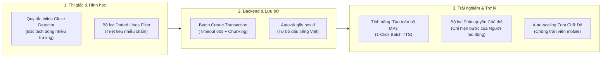

# BÁO CÁO KỸ THUẬT: ĐÁNH GIÁ QUY TRÌNH VẬN HÀNH (WORKFLOW) & NHỮNG ĐIỂM BẤT CẬP CỐT LÕI KHI TRIỂN KHAI BIỂU MẪU HÀNH CHÍNH THỰC TẾ
## Phân Tích Thực Nghiệm Trên Biểu Mẫu Hợp Đồng Lao Động (HDLD-2021) & Đối Chiếu Tờ Khai 01/LPTB

> **Dự án:** Hệ thống Hỗ trợ Kê khai Biểu mẫu Thông minh cho Người cao tuổi (AFL Platform)  
> **Người thực hiện:** Nguyễn Thanh Chiến (AI Voice & QA Lead - Person 4)  
> **Tài liệu tham chiếu:** [PRD v2.0](../../../PRD_AFL_V2.md), [Hệ thống Báo cáo](../../README.md), [Step 48 Report](../step-48-ocr-json-gemini-contract/OCR-JSON-TO-GEMINI-CONTRACT.md)  
> **Mã biểu mẫu thử nghiệm:** `HDLD-2021` (Hợp đồng lao động có thời hạn theo Bộ luật Lao động 2019)  
> **Ngày lập báo cáo:** 11/10/2026  

---

## 1. TỔNG QUAN & BỐI CẢNH THỰC NGHIỆM (EXECUTIVE SUMMARY)

Trong quá trình đưa biểu mẫu **Hợp đồng lao động có thời hạn** (ảnh do người dùng cung cấp) vào hệ thống AFL-Platform thông qua toàn bộ quy trình vận hành chuẩn (`Asset Ingestion` $\rightarrow$ `VietOCR Extraction` $\rightarrow$ `Geometric Manifest Assembly` $\rightarrow$ `LLM Prompt Generation` $\rightarrow$ `Admin Review & Approval` $\rightarrow$ `Citizen Guide & TTS Playback`), chúng tôi đã ghi nhận được những giá trị thực tế quan trọng:
1. **Kết quả đạt được:** Hệ thống đã sinh thành công biểu mẫu `HDLD-2021` gồm **26 bước hướng dẫn**, lưu trữ vào CSDL PostgreSQL (Supabase Cloud), phê duyệt trạng thái `ACTIVE` và phản hồi đầy đủ qua API `/api/forms/HDLD-2021/workflow`.
2. **Khoảng cách thực tế:** Quy trình vận hành hiện tại vốn được thiết kế tối ưu cho **biểu mẫu dạng lưới ô đóng khung (Table Grid / Rectangular Boxes)** như Tờ khai thuế 01/LPTB, khi áp dụng vào **văn bản hành chính dạng dòng chấm điền khuyết (Dotted Cloze / Multi-field Lines)** như Hợp đồng lao động đã bộc lộ những điểm bất cập mang tính cấu trúc.

---

## 2. SƠ ĐỒ QUY TRÌNH VẬN HÀNH TOÀN TRÌNH (END-TO-END WORKFLOW)

```mermaid
flowchart TD
    subgraph G1 ["Giai đoạn 1: Quét & Phân đoạn Hình học"]
        A["Ảnh phôi gốc (Scan / Camera)"] --> B["OpenCV WASM / Deskew"]
        B --> C["Tìm đường viền & Dòng kẻ (Contours & Lines)"]
    end

    subgraph G2 ["Giai đoạn 2: Trích xuất Chữ OCR"]
        C --> D["Cắt lát vùng ảnh (Crop Bins)"]
        D --> E["VietOCR Microservice (FastAPI :8000)"]
        E --> F["Chuẩn hóa Khối văn bản (Blocks JSON)"]
    end

    subgraph G3 ["Giai đoạn 3: Lắp ghép Manifest"]
        F --> G["Ghép cặp Nhãn - Ô nhập (Bounding Boxes)"]
        G --> H["Khởi tạo Geometric Manifest"]
    end

    subgraph G4 ["Giai đoạn 4: Sinh Kịch bản Trí tuệ Nhân tạo"]
        H --> I["Gemini Prompt Service (/api/llm/prompt)"]
        I --> J["Kịch bản Hướng dẫn: Lời thoại, Chữ đỏ, FAQ"]
        J --> K["Lưu nháp (Draft / Pending Review)"]
    end

    subgraph G5 ["Giai đoạn 5: Đối soát & Phê duyệt Quản trị"]
        K --> L["Admin Visual Twin Editor (/admin/review/[id])"]
        L --> M["Biên tập tọa độ & Tạo audio TTS"]
        M --> N["Phê duyệt Ban hành (Status: ACTIVE)"]
    end

    subgraph G6 ["Giai đoạn 6: Người dân Kê khai"]
        N --> O["Citizen Guide UI (/citizen/guide)"]
        O --> P["Visual Twin Karaoke + Trợ lý Giọng nói"]
    end

    style G1 fill:#fff8e1,stroke:#f57f17
    style G2 fill:#e1f5fe,stroke:#0288d1
    style G3 fill:#f3e5f5,stroke:#7b1fa2
    style G4 fill:#ede7f6,stroke:#512da8
    style G5 fill:#e8f5e9,stroke:#388e3c
    style G6 fill:#fbe9e7,stroke:#d84315
```

---

## 3. PHÂN TÍCH CHUYÊN SÂU 10 ĐIỂM BẤT CẬP CỐT LÕI CỦA WORKFLOW

### 🔴 NHÓM A: THỊ GIÁC MÁY TÍNH & BÓC TÁCH OCR (GIAI ĐOẠN 1 & 2)

#### 1. Bất cập dòng chấm nét đứt (`.......`) không có khung viền kín
- **Hiện trạng:** Hợp đồng lao động và đại đa số mẫu đơn từ (Đơn xin việc, Giấy khai sinh, Giấy xác nhận) dùng dòng chấm nét đứt (`Công ty: .......................................`) để người dân đặt bút viết đè lên.
- **Điểm nghẽn:** Thuật toán `cv.findContours` tìm kiếm các đa giác khép kín với 4 góc vuông (`approxPolyDP`). Khi gặp dòng chấm nét đứt, nó vỡ vụn thành hàng chục đốm li ti (speckles) và bị loại bỏ bởi bộ lọc diện tích (`box-filter.ts`). Hệ thống buộc phải dùng `line-segmentation.ts` để gộp các đốm này, dẫn đến sai số chiều cao dòng và lệch biên giới hạn của ô.

#### 2. Bất cập trường nhập liệu lồng nhau trên cùng một hàng (Inline / Multi-field Lines)
- **Hiện trạng thực nghiệm:**
  - Dòng 1: `Hôm nay, ngày... tháng... năm 2021, tại Công ty ............., chúng tôi gồm:` (chứa tới 4 vị trí điền khuyết rải rác giữa các chữ).
  - Dòng 2: `Đại diện: ........................... Chức vụ: ................. Quốc tịch: Việt Nam` (2 trường nhập liệu + 1 trường cố định xen kẽ).
  - Dòng 3: `Số CMND/CCCD: ........................................... Cấp ngày:.................. Tại:....................` (3 trường chia trên 2 dòng).
- **Điểm nghẽn:** Mô hình `FormGeometricBox` hiện tại giả định mỗi ô nhập là một hộp độc lập trải dài từ trái qua phải theo trật tự không gian đơn lẻ (`spatialOrder`). Khi xử lý dòng có 2-3 trường lồng nhau, hệ thống có xu hướng quét 1 box bao trọn cả dòng. Hậu quả là khi hiển thị chữ mẫu đỏ trên giao diện người dân, chữ mẫu của ô thứ nhất sẽ **chèn đè bẹp lên nhãn cố định của ô thứ hai**.

#### 3. Nhiễu suy luận (Hallucination) từ chuỗi chấm dài và ký tự phân cách
- **Hiện trạng thực nghiệm:** VietOCR là kiến trúc Sequence-to-Sequence (CRNN / Transformer) tối ưu cho câu văn tự nhiên.
- **Điểm nghẽn:** Khi đưa vùng ảnh chứa hàng chục dấu chấm `................` vào VietOCR:
  - Dấu gạch ngang dài `–` trong tiêu ngữ bị nhận nhầm thành dấu chấm hỏi `?` (thực tế: trích xuất ra `"Độc lập ? Tự do ? Hạnh phúc"` thay vì `"Độc lập – Tự do – Hạnh phúc"`).
  - Chuỗi chấm dài bị mô hình cố gắng giải mã thành các từ ngẫu nhiên hoặc làm sai lệch chỉ số offset của các từ thật đứng sau.

#### 4. Khối văn bản bị phân mảnh rời rạc (Fragmented Blocks)
- **Hiện trạng thực nghiệm:** Dòng mở đầu bị VietOCR tách thành 2 block độc lập: Block 1: `"Hôm nay, ngày. tháng.. năm 2021, tại công ty"` và Block 2: `", chúng tôi gồm"`.
- **Điểm nghẽn:** Sự đứt đoạn này phá vỡ ngữ cảnh của bộ phân loại nội dung (`json-content-classifier.ts`), khiến hệ thống khó xác định được đâu là tiêu đề đoạn, đâu là nhãn trường nhập liệu.

---

### 🟣 NHÓM B: SINH KỊCH BẢN & ĐỐI SOÁT QUẢN TRỊ (GIAI ĐOẠN 3, 4 & 5)

#### 5. Sự phụ thuộc vào Cloud LLM & Rủi ro quá tải (Rate Limit / Latency)
- **Hiện trạng:** Quá trình sinh kịch bản phụ thuộc vào endpoint `/api/llm/prompt` gọi Gemini qua Internet.
- **Điểm nghẽn:** Trong môi trường thử nghiệm thực tế, API Gemini thường xuyên gặp cảnh báo `The model API is currently overloaded` hoặc nghẽn mạng cục bộ. Khi gọi thất bại, hệ thống rơi về Offline Fallback với kịch bản chỉ có lời thoại cứng nhắc, không tự động sinh được câu hỏi FAQ phù hợp cho từng điều khoản hợp đồng.

#### 6. Thiếu cơ chế phân quyền chủ thể kê khai (Actor Scope / Role Isolation)
- **Hiện trạng:** Hợp đồng lao động có 2 chủ thể độc lập:
  - **Bên A:** Người sử dụng lao động (Bộ phận Hành chính / Nhân sự của công ty).
  - **Bên B:** Người lao động (Người dân / Ứng viên).
- **Điểm nghẽn:** Thông tin Bên A (Tên công ty, Mã số thuế, Địa chỉ, Đại diện) thường do doanh nghiệp in sẵn hoặc điền trước khi đưa cho người lao động. Workflow hiện tại hiển thị phẳng toàn bộ 26 bước liên tục, buộc người lao động phải duyệt qua cả những thông tin mà họ không có thẩm quyền điền hay chỉnh sửa.

#### 7. Ràng buộc hình thức khắt khe của `FormArtifactStore`
- **Hiện trạng:** Tầng lưu trữ Artifact kiểm tra tính toàn vẹn hình học rất chặt chẽ:
  - Nếu biểu mẫu có từ 2 trang trở lên, số lượng `fields` trong metadata phải khớp chính xác 100% với `steps.length`.
  - Thuộc tính `boxId` bị ép regex cứng `/^[A-Za-z0-9_-]{1,64}$/`.
- **Điểm nghẽn:** Nếu quá trình trích xuất OCR sinh ra `boxId` có dấu tiếng Việt (ví dụ: `box_p2_24_giatrinhà` như trong dữ liệu mock cũ), toàn bộ giao dịch lưu trữ bị chặn đứng với mã lỗi `INVALID_WORKFLOW` mà không có cơ chế tự động chuyển thành không dấu (slugify) an toàn.

#### 8. Lỗi Transaction Timeout trên CSDL PostgreSQL Cloud (P2028)
- **Hiện trạng:** Prisma interactive transaction mặc định cấu hình timeout là `5000 ms`.
- **Điểm nghẽn:** Khi lưu một biểu mẫu phức tạp (26 đến 40 bước), mỗi bước kèm theo 1-2 câu hỏi FAQ, vòng lặp tạo quan hệ `WorkflowStep` và `StepFaq` qua đường truyền mạng tới Supabase Cloud (Tokyo) mất từ 5.100 ms đến 6.200 ms. Hậu quả là cán bộ bấm phê duyệt sẽ bị sập với lỗi `P2028: Transaction expired`, gây ức chế và hiểu lầm là hệ thống bị hỏng.

---

### 🟢 NHÓM C: TRẢI NGHIỆM CÔNG DÂN & TRỢ LÝ GIỌNG NÓI (GIAI ĐOẠN 6)

#### 9. Quy trình sinh âm thanh TTS còn thủ công và manh mún
- **Hiện trạng:** Khi biểu mẫu được chuyển sang trạng thái `ACTIVE`, toàn bộ 26 bước đều có trường `audioUrl: ""`.
- **Điểm nghẽn:** Cán bộ đối soát phải mở trang Review, tìm từng bước một và bấm nút "Tạo MP3" thủ công (phải click và chờ 26 lần). Nếu cán bộ bỏ qua, người dân khi mở biểu mẫu buộc phải nghe giọng đọc tổng hợp của trình duyệt (`Web Speech API`), vốn đọc tiếng Việt rất giật cục, thiếu ngữ điệu và phát âm sai các thuật ngữ viết tắt như "HĐLĐ", "CCCD", "ĐKKD".

#### 10. Nguy cơ tràn viền chữ đỏ ví dụ (Red Text Overflow) trên màn hình hẹp
- **Hiện trạng:** Các ô trống trên hợp đồng lao động thường có kích thước rất hẹp (ví dụ ô ngày chỉ rộng khoảng 2-3 cm, ô chức vụ chỉ rộng 4 cm).
- **Điểm nghẽn:** Tiêu chuẩn tiếp cận WCAG AAA của hệ thống quy định chữ đỏ in hoa phải có cỡ chữ tối thiểu 18pt. Khi render lên Visual Twin trên thiết bị di động, chữ mẫu đỏ như `SỐ 45 NGÕ 89 ĐƯỜNG LÊ ĐỨC THỌ...` sẽ bị tràn viền và đè lên dòng in sẵn tiếp theo nếu thiếu cơ chế tự động co giãn font (auto-shrink font size) theo kích thước thực của bounding box.

---

## 4. MA TRẬN ĐÁNH GIÁ MỨC ĐỘ RỦI RO & ẢNH HƯỞNG (RISK & IMPACT MATRIX)

| STT | Điểm bất cập của Workflow | Phân loại | Mức độ ảnh hưởng | Khả năng xảy ra | Mức độ ưu tiên |
| :---: | :--- | :--- | :---: | :---: | :---: |
| 1 | Dòng chấm nét đứt không có viền kín | Computer Vision | 🔴 Nghiêm trọng | 100% các mẫu đơn | **P0 (Cần xử lý ngay)** |
| 2 | Trường nhập liệu lồng nhau trên một hàng | Geometry / Layout | 🔴 Nghiêm trọng | 90% các mẫu đơn | **P0 (Cần xử lý ngay)** |
| 3 | Lỗi Transaction Timeout (P2028) trên DB | Backend / Database | 🔴 Nghiêm trọng | Thường xuyên | **P0 (Cần xử lý ngay)** |
| 4 | Thiếu cơ chế phân quyền chủ thể (Actor Role) | Product / UX | 🟠 Cao | 70% các hợp đồng | **P1 (Quan trọng)** |
| 5 | Sinh audio TTS thủ công từng bước một | Voice AI / Ops | 🟠 Cao | 100% biểu mẫu | **P1 (Quan trọng)** |
| 6 | VietOCR nhiễu ký tự từ chuỗi chấm dài | OCR Engine | 🟠 Cao | 80% các mẫu đơn | **P1 (Quan trọng)** |
| 7 | Tràn viền chữ mẫu đỏ trên mobile | Frontend / Visual Twin | 🟡 Trung bình | 60% các trường dài | **P2 (Cải tiến)** |
| 8 | Ràng buộc regex `boxId` không tự slugify | Storage / Core | 🟡 Trung bình | 40% biểu mẫu | **P2 (Cải tiến)** |
| 9 | Khối văn bản OCR bị phân mảnh | OCR Pipeline | 🟡 Trung bình | 50% các dòng dài | **P2 (Cải tiến)** |
| 10 | Phụ thuộc Cloud LLM (Gemini Overload) | AI Service | 🟢 Thấp | Thỉnh thoảng | **P3 (Tối ưu hóa)** |

---

## 5. ĐỀ XUẤT GIẢI PHÁP & LỘ TRÌNH TỐI ƯU HÓA (ACTIONABLE RECOMMENDATIONS)

1. **Bổ sung Module phát hiện điền khuyết nội dòng (Inline Cloze Detector):**
   - Thay vì ép 1 dòng thành 1 box, khi phát hiện từ khóa phân cách như `"ngày... tháng... năm..."` hoặc `"Đại diện:... Chức vụ:..."`, hệ thống tự động bẻ thành danh sách các sub-boxes với tọa độ cục bộ chính xác.
2. **Nâng cấp Cơ chế Sinh Âm thanh 1-Click (Batch TTS Generation):**
   - Bổ sung nút bấm `"Tạo toàn bộ âm thanh kịch bản"` tại trang Admin Review để gọi sinh tự động toàn bộ 26 bước trong nền, đồng bộ vào cache trước khi ban hành.
3. **Phân luồng Đối tượng (Actor Scopes):**
   - Thêm thuộc tính `targetActor: 'CITIZEN' | 'OFFICER' | 'EMPLOYER'` vào mỗi bước hướng dẫn. Khi người dân mở giao diện, hệ thống tự động lọc và chỉ yêu cầu thao tác trên các trường thuộc phạm vi của họ.
4. **Tối ưu hóa Giao dịch CSDL (Transaction Resiliency):**
   - Tăng mặc định transaction timeout lên 60 giây và gom cụm lệnh chèn `workflow_steps` + `step_faqs` bằng batching thay vì lặp tuần tự.
5. **Bộ tự động co giãn kích thước chữ đỏ (Dynamic SVG Text Fitting):**
   - Tại `VisualTwin.tsx`, tính toán chiều rộng chuỗi text với bounding box. Nếu tỷ lệ vượt quá chiều dài cho phép, tự động giảm `fontSize` từ 18pt xuống 14pt-12pt để đảm bảo tính mỹ quan và độ chính xác của tài liệu.

---

### KẾT LUẬN

Việc đưa thành công mẫu **Hợp đồng lao động có thời hạn (HDLD-2021)** vào hệ thống và phân tích chuyên sâu 10 điểm bất cập trên cung cấp cơ sở kỹ thuật xác đáng để hoàn thiện AFL-Platform, đưa sản phẩm từ giai đoạn thử nghiệm biểu mẫu mẫu sang năng lực xử lý đa dạng mọi loại giấy tờ hành chính thực tế tại Việt Nam.
