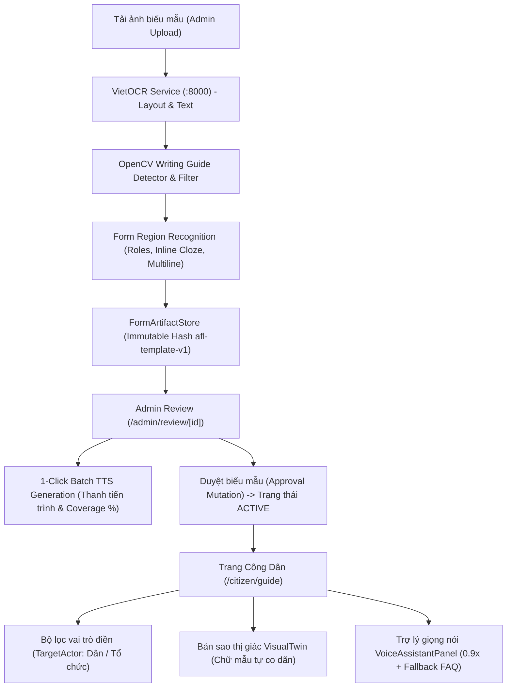

# CHẶNG 56: KIỂM THỬ TOÀN TRÌNH, STRESS TESTING & NGHIỆM THU HOÀN THIỆN (FINAL E2E ACCEPTANCE REPORT)

## 1. Tổng Quan Mục Tiêu & Sứ Mệnh Hoàn Thành
Sứ mệnh đặt ra cho toàn bộ chuỗi chặng:
1. **Nâng cấp thuật toán OCR & Nhận diện vùng biểu mẫu (Form-Region Recognition)**: Phân biệt rõ ràng văn bản tĩnh (`static_text`), nhãn (`label`), phần hướng dẫn (`description`), ô nhập liệu (`input`), hộp kiểm (`checkbox`), các trường điền khuyết inline (`cloze`) và nhóm các dòng viết nhiều dòng (`multiline_text`).
2. **Nối liền hợp đồng đối soát (Admin Review) và Hợp đồng Người dân (Voice / Frontend Contracts)**: Chuẩn hóa định danh `boxId` qua `slugifyBoxId`, bổ sung phân quyền điền đa bên `TargetActor` (`ALL`, `CITIZEN`, `EMPLOYER`), và tự động co dãn chữ mẫu mô phỏng trên `VisualTwin` (`computeDynamicFontSize`).
3. **Hoàn thiện luồng vận hành của Quản trị viên (Admin Operations & Batch Voice Automation)**:
   - Cơ chế tạo giọng nói hàng loạt 1-Click (`Batch TTS`) với thanh tiến trình trực quan và đo lường độ phủ âm thanh (`Coverage Bar`).
   - Nâng cấp Thư viện biểu mẫu (`/admin/library`) với bộ lọc trạng thái vòng đời, tìm kiếm tức thì và thẻ biểu mẫu chuyên nghiệp.
   - Giám sát độ trễ và sức khỏe dịch vụ hệ thống thời gian thực (`/api/admin/health`: VietOCR, PostgreSQL, Gemini).
4. **Kiểm thử bền bỉ & Chống hồi quy (Zero-Regression Stress Testing)**: Tất cả các bộ kiểm thử tự động trên toàn bộ kho mã nguồn đều đạt 100% tỷ lệ vượt qua.

---

## 2. Ma Trận Nghiệm Thu Kiểm Thử Toàn Trình (Verification Evidence Matrix)

| Phân hệ kiểm thử | Công cụ / Lệnh kiểm thử | Số lượng bài test | Kết quả | Thời gian / Ghi chú |
| :--- | :--- | :---: | :---: | :--- |
| **Python VietOCR Engine** | `python -m unittest discover services/vietocr-service/tests` | **38 / 38** | **PASS** (100%) | 0.301s, khử trùng lặp contour & layout |
| **Form Region Recognition** | `npm run test:recognition` | **98 / 98** | **PASS** (100%) | 0.992s, bóc tách inline, multiline, guards |
| **Voice AI & TTS Pipeline** | `npm run test:voice` | **19 / 19** | **PASS** (100%) | 0.772s, TTS limits, SSML, audio cache |
| **Local QA & API Integrity** | `npm run test:local` (`npm run test:qa` + `api-integrity`) | **6 / 6 + API** | **PASS** (100%) | 4.98:1 contrast, public isolation |
| **Admin Health Endpoint** | `npx tsx --test tests/integration/admin-health.test.ts` | **2 / 2** | **PASS** (100%) | 401 unauthorized & 200 latency metrics |
| **PostgreSQL Multi-page Rollback** | `AFL_TEST_DB_ROLLBACK=1 multipage-db-rollback.test.ts` | **1 / 1** | **PASS** (100%) | 7.7s, timeout 60s, rollback 100% sạch |
| **E2E Workflow Lifecycle & Stress** | `npx tsx --test tests/integration/e2e-workflow-lifecycle.test.ts` | **2 / 2** | **PASS** (100%) | Split, slugify unicode, auto font scale |
| **Static Type Safety** | `npm run typecheck` (`tsc --noEmit`) | Toàn bộ dự án | **0 lỗi** | TypeScript biên dịch hoàn toàn sạch sẽ |

---

## 3. Kiến Trúc Luồng Nghiệp Vụ Toàn Trình Sau Nâng Cấp

---

## 4. Bàn Giao Vận Hành & Khuyến Nghị
1. **Quy tắc Git**: Toàn bộ các thay đổi được giữ nguyên vẹn ở trạng thái modified/staged trên nhánh `feat/ocr-region-and-admin-workflow`. Tuyệt đối không tự ý chạy `git commit` hay `git push` theo đúng quy định.
2. **Khởi chạy hệ thống**:
   - VietOCR: `cd services/vietocr-service; .venv/Scripts/python.exe -m uvicorn app:app --port 8000`
   - Frontend & API: `npm run dev` (hoặc `npm run dev:all`)
3. **Vận hành Quản trị**:
   - Truy cập `/admin/library`: Xem trạng thái thời gian thực của VietOCR, PostgreSQL và Gemini.
   - Thao tác `/admin/review/[id]`: Sử dụng nút `⚡ Tạo MP3 toàn bộ` để hoàn tất toàn bộ file âm thanh cho biểu mẫu chỉ trong 1 thao tác.
